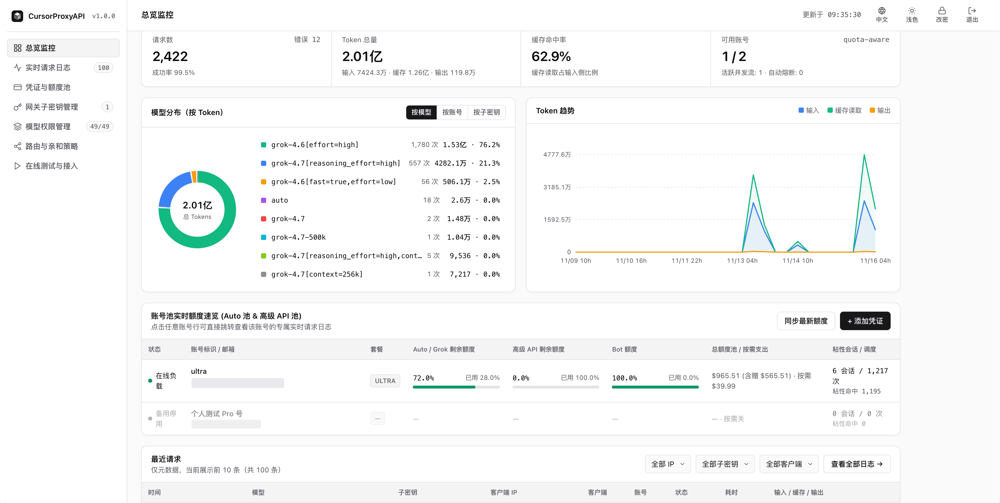
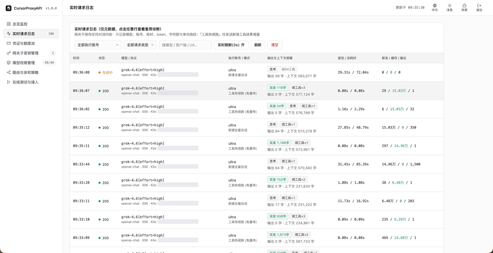
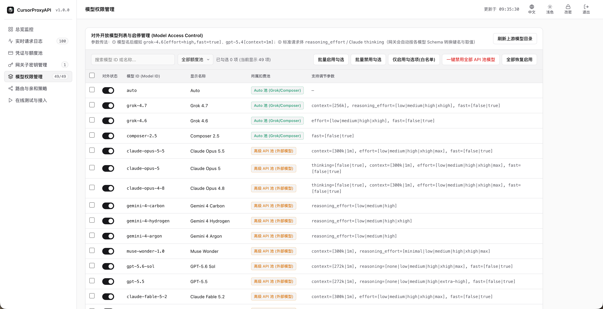
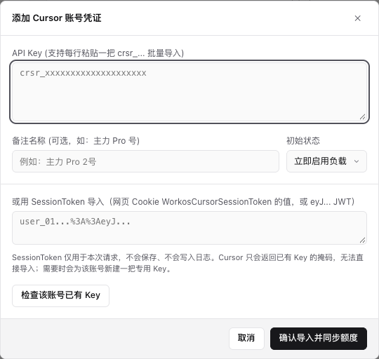
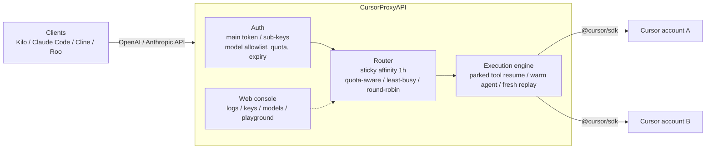

# CursorProxyAPI

简体中文 | **[English](./README_EN.md)**

基于 **`@cursor/sdk`** 构建的单进程、高性能 **OpenAI & Anthropic Claude 双协议 API 网关**。

> **非官方项目与合规声明**：本项目为独立的第三方开源软件，与 **Anysphere, Inc. (Cursor)** 无任何官方关联、背书或赞助关系。本项目**仅限个人订阅者用于自身开发工具的协议互通**；严禁将个人 Cursor 账号池化、出租、转售、搭建商业 API 中转站或分享给多人使用（此类行为违反 [Cursor Terms of Service](https://cursor.com/terms-of-service) §1.5 与 Acceptable Use Policy，可能导致账号被永久封禁且不予退款）。`@cursor/sdk` 专有依赖不在本仓库分发，请由最终用户本地自行拉取；**严禁对外发布包含 `node_modules/@cursor/sdk` 的预构建 Docker 镜像或压缩包**。

将 Cursor Pro / Ultra 官方 API Key (`crsr_...`) 转换为标准的 **OpenAI** 与 **Anthropic Claude** 接口，单进程运行、无数据库依赖，开箱接入主流 AI 编程助手与客户端。

| 能力维度 | 说明 |
|---|---|
| **双协议接口** | OpenAI (`/v1/chat/completions`, `/v1/responses`, `/v1/models`) · Anthropic (`/v1/messages`, `/v1/messages/count_tokens`) |
| **兼容客户端** | **Claude Code、Kilo Code、Roo Code、Cline、OpenCode、Codex CLI、Cherry Studio、NextChat** 及官方 OpenAI / Anthropic / Vercel AI SDK |
| **执行与调度** | 三级续跑（工具挂起续跑 / Warm 前缀复用 / 无状态兜底）· 工具必填参数预校验纠错 · 15s SSE 心跳保活 |
| **多账号与额度** | 多 `crsr_` 号池（`quota-aware` / `least-busy` / `round-robin`）· 1h 粘性亲和 · 耗尽/401 自动切号熔断 · 按账号开关 On-Demand |
| **隔离与子密钥** | 独立 `sk-cgw-...` 子密钥（按模型白名单、并发上限、调用次数、过期时间管控）· `scope` 严格隔离，多人使用不串话 |
| **隐私与安全** | **日志与账本不存任何对话正文**（仅元数据、UA 与单向指纹）· 常量时间鉴权 · CSRF 校验 · 可配置 `TRUST_PROXY` · 防爆破锁定 |
| **Web 控制台** | 零外部前端依赖 · 深/浅双主题 · 用量趋势与客户端识别 · 模型一键启停 · `ALLOW_NATIVE_WEB_TOOLS` 热更新开关（默认关闭） |

---

---

## 控制台界面预览 (Web Console)

内置无需安装任何外部前端框架的自绘 Web 控制台，支持深/浅双主题、交互式图表、实时日志诊断与模型管理：

| 总览监控大盘（Token 趋势、模型/账号分布、账号池额度速览） |
| :---: |
|  |

| 实时请求日志（元数据、上下文与输出规模、耗时、客户端 UA 分类） | 模型权限与参数管控（48+ 模型启停、Schema 调节） |
| :---: | :---: |
|  |  |

| 账号凭证与 SessionToken 一键导入（支持批量 crsr_ 导入 / Cookie 免密自动新建 Key） |
| :---: |
|  |

---

## 核心特性与硬核亮点

- **企业级多账号池与智能轮询**：
  - 支持 **`Quota-Aware`（余量感知 + 最少活跃流优先）**、`Least-Busy`、`Round-Robin` 三大负载均衡策略。
  - **1 小时粘性会话亲和（Sticky Affinity）**：同一客户端对话窗口智能锁定同一账号，免长文本重复上传。
  - **零感无缝切号与自动熔断**：A 账号额度耗尽或失效时，当前请求无感漂移到 B 账号继续生成并自动熔断 A，支持按账号独立启停 On-Demand（超额计费拦截）。
- **SessionToken ↔ API Key 双向互通与免密管理**：
  - **支持 SessionToken 一键导入**：直接填入浏览器 Cookie `WorkosCursorSessionToken`，网关自动调用官方鉴权中心兑换短期凭据并一键生成/导入可用 `crsr_` Key（省去手动进官网提取的繁琐步骤）。
  - **反向 Key 提取与实时额度同步**：支持提取已绑账号的 API Key 列表；仅在管理员手动触发时同步 **Auto/Grok 池**、**高级 API 池**与**按需账单**（0 后台轮询打扰）。
- **三级自适应热续跑引擎（0 断流、极速首包）**：
  1. **Tier 1 工具挂起热续跑**：内存挂起等待客户端回传 `tool_result`，次轮首包延迟低至 `~1.5s`；内置**参数智能自愈（`repairToolArgs`）**，模型误写 `path`/`file_path` 时网关自动映射为 `filePath`，杜绝客户端红框报错。
  2. **Tier 2 Warm LRU 增量复用**：`scope` 严格物理隔离，相同前缀仅传增量，大幅提高云端 `cached_tokens` 命中率。
  3. **Tier 3 无状态重放兜底**：遇客户端 `/compact` 压缩历史或云端 summary 时平滑放行，彻底告别传统网关 `413`/`499` 顽疾。
- **全功能 Web 控制台（全部配置网页搞定，无需重启）**：
  - 零外部前端依赖的极简工业风界面，深/浅双主题，敏感路由防爆破（8 次失败锁 15 分钟）。
  - **全站配置热更新**：算法切换、粘性时间、熔断策略、上游 Key 增删改查、48+ 模型启停与参数 Schema 调整、子密钥权限全在网页端即时修改并自动持久化，**绝大部分日常配置 0 命令行、0 重启服务**！
- **精细化租户子密钥（适合分发团队/朋友）**：
  - 签发多把 `sk-cgw-...` 子密钥，每把可独立设定：**可用模型白名单**、**并发上限**、**总调用次数**与**有效期**。
  - 严格的会话 `scope` 物理隔离，多人共享同一网关绝不串话，用量图表清晰溯源。
- **承诺级隐私零留存**：
  - 唯一生产依赖仅 `@cursor/sdk`，纯内存瞬态存储（0 SQLite 磁盘残留）；请求日志与用量账本**仅存元数据、客户端分类与单向指纹**，代码级禁止留存对话正文。

---

## 系统架构



## 快速启动与部署

> **极简理念**：**配置全在 Web 控制台完成**。你只需把服务跑起来并设一个管理员密码，其余的上游账号绑定、算法选择、子密钥签发、模型启停，直接在浏览器里点点鼠标即可，绝大部分日常操作无需再改 `.env`，也无需重启服务。

### 方式一：让 AI 助手一键全自动部署（强烈推荐，最省心）

直接克隆仓库，把下面这句提示词发给你的 AI（Claude Code / Kilo / Cursor / OpenCode）：
```text
帮我部署当前目录的 CursorProxyAPI：检查本机是否有 Docker 或 Node.js >= 22.13（优先 Docker Compose）；自动生成随机的 ADMIN_PASSWORD 与 DASHBOARD_PATH 写入配置（其余保持默认安全值）；启动服务后告诉我 Web 控制台访问地址与登录密码。
```

---

### 方式二：Docker Compose 极简部署（推荐）

```bash
git clone https://github.com/<your-username>/CursorProxyAPI.git && cd CursorProxyAPI
mkdir -p data && sudo chown -R 1000:1000 data
cp .env.example data/.env
# 编辑 data/.env 设置 ADMIN_PASSWORD（公网建议顺便修改 DASHBOARD_PATH）
docker compose up -d --build
```

---

### 方式三：裸机快速启动（Node.js >= 22.13）

```bash
git clone https://github.com/<your-username>/CursorProxyAPI.git && cd CursorProxyAPI
cp .env.example .env
# 编辑 .env 设置 ADMIN_PASSWORD
npm ci && npm run build && npm start
```
*(如需 Linux Systemd 开机守护与 Caddy/Nginx 反代配置，完整模板已归档至 [`docs/DEPLOY-RUNBOOK.md`](./docs/DEPLOY-RUNBOOK.md) 可随时查阅)*

---

### 🚀 启动后 2 步进入使用：

1. 打开浏览器访问控制台（默认路径 `http://127.0.0.1:6718/dashboard` 或你的自定义路径），输入 `ADMIN_PASSWORD` 登录。
2. 点击卡片右上角 **「+ 添加凭证」**，填入你的 Cursor `crsr_...` Key（或直接粘贴网页 Cookie 中的 `SessionToken` 一键自动生成）。
3. **完成！** 直接使用首次启动自动生成的默认密钥（在控制台「网关子密钥管理」中点击复制），或在客户端填入网关地址即可开工！

---

## 客户端接入使用指南

> 假设你的公网网关地址为 `https://api.example.com/cursor`（若为独立子域名则去掉 `/cursor` 后缀），你在后台「网关子密钥管理」复制的调用密钥为 `sk-cgw-xxxx`。

### 1. OpenAI 兼容协议接入（强烈推荐用于通用客户端）

适用于 **Kilo Code、Roo Code、Cline、Cherry Studio、NextChat、OpenAI Python/JS SDK**：
- **API 协议类型**：`OpenAI Compatible`
- **Base URL**：`https://api.example.com/cursor/v1`
- **API Key**：`sk-cgw-xxxx`（你的网关主密钥或子密钥）

**Kilo Code (`~/.config/kilo/kilo.jsonc`) 配置示例**：
```jsonc
{
  "provider": {
    "my-cursor": {
      "npm": "@ai-sdk/openai-compatible",
      "name": "CursorProxyAPI",
      "options": {
        "baseURL": "https://api.example.com/cursor/v1",
        "apiKey": "sk-cgw-xxxx"
      },
      "models": {
        "grok-4.6[fast=true,effort=low]": {
          "name": "Cursor · Grok 4.6 Fast",
          "attachment": true,
          "reasoning": true,
          "tool_call": true,
          "limit": { "context": 205000, "output": 65536 }
        },
        "grok-4.6[effort=high]": {
          "name": "Cursor · Grok 4.6 High",
          "attachment": true,
          "reasoning": true,
          "tool_call": true,
          "limit": { "context": 205000, "output": 65536 }
        },
        "composer-2.5[fast=true]": {
          "name": "Cursor · Composer 2.5 Fast",
          "attachment": true,
          "reasoning": true,
          "tool_call": true,
          "limit": { "context": 200000, "output": 65536 }
        }
      }
    }
  }
}
```

**cURL 快速测试**：
```bash
# 1. 获取当前子密钥被授权访问的模型列表
curl https://api.example.com/cursor/v1/models \
  -H "Authorization: Bearer sk-cgw-xxxx"

# 2. 发起流式对话
curl https://api.example.com/cursor/v1/chat/completions \
  -H "Authorization: Bearer sk-cgw-xxxx" \
  -H "Content-Type: application/json" \
  -d '{
    "model": "grok-4.6[effort=high]",
    "stream": true,
    "messages": [{"role": "user", "content": "你好，请介绍一下你自己"}]
  }'
```

---

### 💡 核心最佳实践：客户端上下文窗口预留 15%~20%（防断流与降智）

长对话场景（如大型项目重构、多文件分析）下，强烈建议在 AI 客户端配置**预留 15%~20% 上下文裕量**并开启**自动提前压缩（Auto Compact）**：

- **为什么不能直接填满 256k？**
  虽然 Cursor 官方对 `grok-4.6` / `grok-4.7` 等模型的物理上限是 `256k`（约 262,144 tokens），但单轮工具调用可能吐出庞大的代码或日志。若客户端将 `limit.context` 设满为 `262144`，一旦临近顶峰才被动触发压缩，容易直接撞上 Cursor 云端的硬性断流线（导致 `413 Request Entity Too Large` / `499` 报错），或触发云端强制截断导致模型“降智”。
- **黄金配置原则**：
  将客户端的 Context Limit 设置为物理上限的 **`80% ~ 85%`（约 `200,000 ~ 210,000 tokens`）**。
  - **Kilo Code**：在 `~/.config/kilo/kilo.jsonc` 开启自动压缩并设置安全上限：
    ```jsonc
    {
      "compaction": { "auto": true, "prune": true },
      "provider": {
        "my-cursor": {
          "models": {
            "grok-4.7[reasoning_effort=high]": {
              "limit": { "context": 205000, "output": 65536 }
            }
          }
        }
      }
    }
    ```
  - **Cline / Roo Code**：在 `Custom Context Window Size` 中填入 `205000`（不要填满 262144），让客户端在达到 80% 时在本地完成总结浓缩，再平滑将精简上下文喂给网关，永不爆窗。

---

### 2. Anthropic Claude 原生协议接入（适用于 Claude Code CLI 等）

网关完整实现了 `POST /v1/messages` 与 `POST /v1/messages/count_tokens`，同时兼容 `x-api-key` 与 `Authorization: Bearer` 鉴权头：

```bash
export ANTHROPIC_BASE_URL="https://api.example.com/cursor"
export ANTHROPIC_API_KEY="sk-cgw-xxxx"

# 启动 Claude Code CLI 并指定模型
claude --model "grok-4.6[effort=high]"
```

---

### 3. 模型调节参数传递语法

网关会自动根据上游 48+ 模型的实时 Schema 翻译思考键名（`effort` / `reasoning_effort` / `reasoning` / `thinking`）并吸附合法枚举值：

1. **模型名方括号语法（推荐，全客户端通用）**：
   - 思考强度：`grok-4.6[effort=low]`、`grok-4.6[effort=high]`、`gpt-5.4[effort=xhigh]`
   - 极速通道：`composer-2.5[fast=true]`、`grok-4.6[fast=true,effort=low]`
   - 大上下文窗口：`claude-opus-5-5[effort=high,context=1m]`（或简写 `claude-opus-5-5[1m]`）
2. **标准请求体字段语法**：
   - OpenAI 请求体传 `"reasoning_effort": "low" | "medium" | "high" | "xhigh"`、`"service_tier": "priority"`；
   - Anthropic 请求体传 `"thinking": { "type": "enabled", "budget_tokens": 16000 }`。

---

## 协议兼容边界（诚实说明）

Cursor SDK 只接收一段 prompt，不提供采样与结构化输出控制，因此网关对下列参数的处理是：

| 参数 | 行为 |
|---|---|
| `temperature` `top_p` `top_k` `max_tokens` `max_completion_tokens` `max_output_tokens` `stop` `stop_sequences` `seed` 等 | 接受但**不生效**；响应头 `x-gateway-ignored-params` 会列出被忽略的参数名 |
| `response_format` / `text.format`（`json_schema`/`json_object` 等非 `text` 类型）、`n` 不为 1、Responses 的 `previous_response_id` | 返回 **400** `unsupported_parameter`，`param` 指向对应字段 |
| Anthropic `/v1/messages` 缺少 `max_tokens` | 返回 **400**（官方同款必填；该值仍不截断上游输出，仅作协议校验） |
| `tool_choice: required / 指定工具` | 以系统段提示实现；多工具时要求**至少调用其中之一**；对话里已有工具结果后不再强制 |
| 工具参数缺少必填字段 | 网关按客户端声明的 `required` 预校验；模型漏填或写错字段名时，同一次运行内先回灌一次错误让模型自行纠正，客户端看不到这次失败；同一工具再次出错则原样转发，由客户端校验把关 |
| 含工具调用的对话 | 工具调用后回传 `tool_result` 走 **Tier 1 内存挂起续跑**；纯文本连续对话走 **Tier 2 Warm 复用**；跨轮含工具历史新建代理走 **Tier 3 重放** |
| Anthropic `thinking.signature` | 网关生成虚拟签名 `cursor-gateway-thinking`（同网关多轮可用，若中途切回 Anthropic 官方 API 可能因签名不识别报 400） |
| 图片输入 | 仅支持 `base64` Data URL；远程 `http(s)://` 图片 URL 在本地 SDK 模式下返回 400 |

## 环境变量一览 (`.env`)

| 变量名 | 默认值 | 说明 |
|---|---|---|
| `HOST` | `127.0.0.1` | 监听地址（反代本机部署用 `127.0.0.1`，Docker 内用 `0.0.0.0`） |
| `PORT` | `6718` | 监听端口 |
| `GATEWAY_TOKEN` | 空 | 初始客户端调用主密钥（首次启动自动导入 `gateway-keys.json`）。**不存在开放模式**：没有任何客户端 key 时网关拒绝启动 |
| `ENABLE_DASHBOARD` | `true` | 设为 `false` 则不挂载控制台与 `/v1/admin/*`（纯无头代理） |
| `TRUST_PROXY` | `loopback` | 转发头信任策略：`loopback`（仅本机反代）\| `all` \| `off`（直连公网务必设为 `off`） |
| `ALLOW_NATIVE_WEB_TOOLS` | `false` | 是否允许客户端通过 `web_search*` / `web_fetch` 启用 Cursor 云端联网工具（支持后台热更新开关；公网共享保持 `false`，防额外消耗额度与滥用） |
| `DATA_DIR` | `.env` 所在目录 | 运行时状态目录（保存 `gateway-keys.json`、`admin-session.key`、`usage-ledger.json`） |
| `RECORD_CLIENT_IP` | `true` | 总览账本是否记录客户端 IP（只记 IP 与 token 计数，**不记录任何对话内容**）；设为 `false` 则不记 IP |
| `USAGE_LEDGER_FILE` | `.env` 同目录 `usage-ledger.json` | 总览账本落盘位置（按小时聚合，保留 30 天） |
| `ADMIN_PASSWORD` | 空 | 管理控制台独立登录密码（与调用密钥物理隔离）。**未设置则后台整体禁用**，不会回退使用 `GATEWAY_TOKEN` |
| `DASHBOARD_PATH` | `/dashboard` | **安全建议**：生产环境设为随机私密路径（如 `/adm-9f4c2e`），防扫描探测 |
| `CURSOR_API_KEYS` | 空 | 启用的 Cursor 官方 `crsr_...` 密钥列表（英文逗号分隔） |
| `LB_STRATEGY` | `quota-aware` | 负载均衡策略：`quota-aware` \| `least-busy` \| `round-robin` |
| `SESSION_AFFINITY_ENABLED` | `true` | 是否开启跨轮次粘性会话亲和锁定 |
| `SESSION_AFFINITY_TTL_MS` | `3600000` | 粘性会话亲和保持时间（默认 1 小时） |
| `AUTO_DISABLE_EXHAUSTED_KEYS` | `true` | 账号额度耗尽或 401 失效时自动切流并熔断关停故障号 |
| `MAX_BODY_BYTES` | `16777216` | 协议请求体上限（16MiB）；超限立即 413 JSON，反代也应设相同 `request_body max_size` |

---

## 隐私与日志

网关日志与用量账本不存对话。这是代码级约束，并有测试守护（`test/gateway.test.ts` 中的 "request log never holds conversation text"）。`@cursor/sdk` 默认仍可能把 jsonl transcript 写到 `$HOME/.cursor/projects/<workspace>/agent-transcripts`；网关在 agent close 时尽力删除。systemd `ProtectHome=true` 会挡住该写入（EACCES）。

| 项目 | 是否保存 |
|---|---|
| 系统提示、用户消息、助手回复、思考链 | 不保存 |
| 工具调用参数与工具返回结果 | 不保存 |
| 模型名、子密钥名、客户端 IP（可用 `RECORD_CLIENT_IP=false` 关闭）、执行账号 | 保存（内存 + 用量账本） |
| 耗时、首包时间、token 数、输出/上下文字符数、消息数、状态码 | 保存 |
| 会话与前缀指纹 | 保存 8 位单向短哈希，仅用于判断两次请求是否同一对话前缀，无法还原内容 |

- 请求日志是内存环形缓冲（最多 100 条），重启即丢；用量账本只落盘元数据（`USAGE_LEDGER_FILE`）。
- 请求本身仍必须经网关转发给 Cursor，这是反代的本质；这里说的是"网关不留存"。
- 排查"是否串话/复用"请看日志详情里的执行模式与前缀指纹，不需要也不会读到任何对话文本。

## 开源协议与致谢

- 本项目基于 **[MIT License](./LICENSE)** 开源。
- 早期关于 `@cursor/sdk` 本地 `customTools` MCP 回调机制的可行性验证参考了 [iFwu/cursor2response](https://github.com/iFwu/cursor2response)（MIT License），特此致谢；本项目采用完全独立的单进程多账号架构重写。
- **严谨使用声明**：请勿对外发布预构建的包含 `node_modules/@cursor/sdk` 的 Docker 镜像或压缩包；用户需通过源码 `npm ci` 或本机 `docker compose up -d --build` 自行安装依赖。
- `@cursor/sdk` 为 Anysphere Inc. 专有软件（All rights reserved），本仓库不包含也不分发任何专有 SDK 文件。
