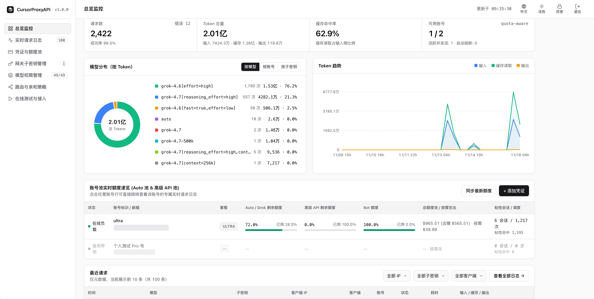
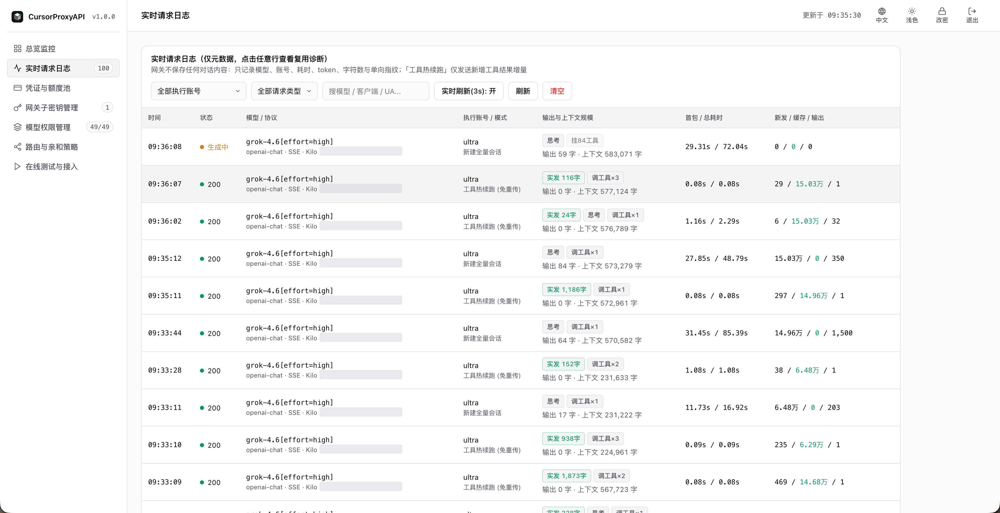
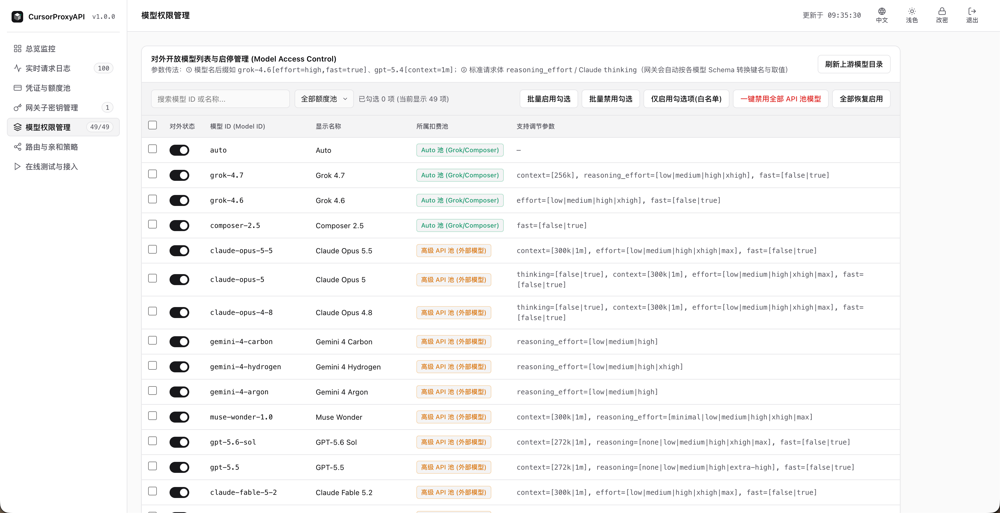
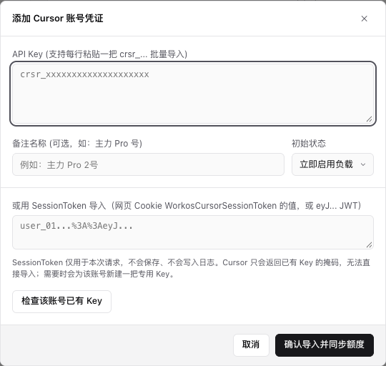
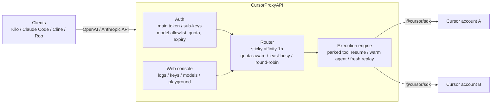

# CursorProxyAPI

**[简体中文](./README.md)** | English

A single-process, high-performance **OpenAI & Anthropic Claude dual-protocol API gateway** built on **`@cursor/sdk`**.

> **Disclaimer & Acceptable Use**: This is an independent, unofficial open-source project and is **NOT affiliated with, endorsed by, or sponsored by Anysphere, Inc. ("Cursor")**. It is intended strictly for **personal interoperability by individual Cursor subscribers** with their own tools. Pooling, renting, reselling, or sharing individual Cursor accounts across multiple users or commercial API relays violates [Cursor's Terms of Service](https://cursor.com/terms-of-service) (§1.5) and Acceptable Use Policy and may result in permanent, non-refundable account termination. `@cursor/sdk` is **not** distributed in this repository; **do NOT publish pre-built Docker images or archives containing `node_modules/@cursor/sdk`**.

Turn your Cursor Pro / Ultra User API Key (`crsr_...`) into standard **OpenAI** and **Anthropic Claude** endpoints — single-process, zero-database, ready for AI coding CLIs and SDKs out of the box.

| Capability | Summary |
|---|---|
| **Dual Protocols** | OpenAI (`/v1/chat/completions`, `/v1/responses`, `/v1/models`) · Anthropic (`/v1/messages`, `/v1/messages/count_tokens`) |
| **Supported Clients** | **Claude Code, Kilo Code, Roo Code, Cline, OpenCode, Codex CLI, Cherry Studio, NextChat**, official OpenAI / Anthropic / Vercel AI SDKs |
| **Execution Engine** | 3-tier continuation (Parked Tool / Warm Prefix / Stateless Replay) · Required-arg pre-flight validation · 15s SSE keepalive |
| **Multi-Account Pool** | `quota-aware` / `least-busy` / `round-robin` · 1h sticky affinity · Auto failover & circuit-breaker · Per-account On-Demand toggle |
| **Tenant Sub-Keys** | Scoped `sk-cgw-...` sub-keys (model allowlists, concurrency caps, max requests, expiry) · Strict per-scope session isolation |
| **Privacy & Security** | **Metadata-only logs & ledger** (zero prompt/reply retention) · Constant-time auth · CSRF protection · `TRUST_PROXY` · Brute-force throttle |
| **Web Console** | Dependency-free UI · Light/Dark themes · Usage charts & client classification · Model allow/deny · Hot-reload `ALLOW_NATIVE_WEB_TOOLS` toggle |

---

---

## Web Console Preview

A dependency-free monochrome Web Console with light/dark themes, interactive charts, real-time metadata logs, and granular model access control:

| Overview Dashboard (Token Trends, Model/Account Distribution, Live Quotas) |
| :---: |
|  |

| Live Request Logs (Metadata, Token Scale, TTFT, Client UA Classes) | Model Access & Parameter Control (48+ Models, Schema Mapping) |
| :---: | :---: |
|  |  |

| Account Credential & SessionToken Import (Batch crsr_ paste / 1-click Cookie token exchange) |
| :---: |
|  |

---

## Key Features & Hardcore Highlights

- **Enterprise Multi-Account Pooling & Intelligent Load Balancing**:
  - Three routing strategies: **`Quota-Aware` (remaining quota + least active streams)**, `Least-Busy`, and `Round-Robin`.
  - **1-Hour Sticky Session Affinity**: Pins client chat sessions to the same upstream account, avoiding repeated context uploads.
  - **Seamless Failover & Circuit Breaking**: If account A runs out of quota or hits 401, the active request seamlessly fails over to account B while auto-disabling A; supports independent On-Demand (overage protection) per account.
- **SessionToken ↔ API Key Dual Conversion & Zero-Friction Setup**:
  - **1-Click Import via SessionToken**: Paste your browser cookie `WorkosCursorSessionToken` directly; the gateway exchanges it with Cursor's auth service to query or generate usable `crsr_` keys on the fly.
  - **Reverse Key Export & On-Demand Quota Sync**: Inspect registered API keys and sync live **Auto/Grok pools**, **Premium API pools**, and **On-Demand spend** with zero background polling spam.
- **3-Tier Adaptive Continuation Engine (Zero 413/499 Drops)**:
  1. **Tier 1 — Fast-Path Parked Tool Continuation**: Suspends in-memory Promises for 40+ parallel tools; next-turn TTFT as fast as `~1.5s`; features **Transparent Argument Auto-Repair (`repairToolArgs`)** that maps `path`/`file_path` to `filePath` to eliminate client schema rejections.
  2. **Tier 2 — Warm LRU Incremental Pool**: Strictly scoped in-memory sessions that send only delta turns to maximize cloud `cached_tokens`.
  3. **Tier 3 — Stateless Fallback**: Smoothly handles client `/compact` history compression without stream dropouts.
- **Full-Featured Web Console (Configure Everything in Browser, Zero Restarts)**:
  - Dependency-free monochrome UI with light/dark themes and rate-limited brute-force lockout.
  - **Live Hot-Reloading**: Routing algorithms, affinity TTL, circuit breakers, upstream keys, 48+ model allowlists/schemas, and client sub-keys can all be configured directly in the browser and persist instantly—**no command line or service restart needed for routine ops**!
- **Granular Multi-Tenant Sub-Keys**:
  - Issue custom `sk-cgw-...` keys with **per-key model allowlists**, **concurrency caps**, **request counts**, and **expiration dates**.
  - Strict physical session `scope` isolation ensures multiple users sharing one gateway never experience crosstalk or prompt pollution.
- **Strict Metadata-Only Privacy Guarantee**:
  - Only 1 production dependency (`@cursor/sdk`), backed by in-memory `EphemeralMemoryStore` (0 bytes of SQLite residue). Logs and ledger store **timings, token metrics, client UA classes, and 8-char one-way hashes—never conversation text**.

---

## Architecture



## Quick Start & Deployment

> **Minimalist Philosophy**: **Configure everything inside the Web Console**. All you need is to start the service with an admin password. Adding accounts, switching routing algorithms, issuing sub-keys, and toggling models are done entirely in your browser—no CLI edits or restarts required for routine ops!

### Option 1: One-Click AI Agent Deployment (Recommended)

Clone the repo and paste this prompt directly into your AI assistant (Claude Code / Kilo / Cursor / OpenCode):
```text
Deploy CursorProxyAPI in this directory: check for Docker or Node.js >= 22.13 (prefer Docker Compose); generate a random ADMIN_PASSWORD and DASHBOARD_PATH in config (keep other safe defaults); start the service and give me the Console URL and admin password.
```

---

### Option 2: Docker Compose (Fast & Clean)

```bash
git clone https://github.com/<your-username>/CursorProxyAPI.git && cd CursorProxyAPI
mkdir -p data && sudo chown -R 1000:1000 data
cp .env.example data/.env
# Edit data/.env to set ADMIN_PASSWORD (and optionally DASHBOARD_PATH)
docker compose up -d --build
```

---

### Option 3: Local Node.js (Node.js >= 22.13)

```bash
git clone https://github.com/<your-username>/CursorProxyAPI.git && cd CursorProxyAPI
cp .env.example .env
# Edit .env to set ADMIN_PASSWORD
npm ci && npm run build && npm start
```
*(For Linux Systemd daemon & Caddy/Nginx reverse proxy templates, see the comprehensive [`docs/DEPLOY-RUNBOOK.md`](./docs/DEPLOY-RUNBOOK.md))*

---

### 🚀 Ready in 2 Steps:

1. Open your browser and navigate to the Web Console (e.g. `http://127.0.0.1:6718/dashboard` or your custom path), and log in with `ADMIN_PASSWORD`.
2. Click **`+ Add Credential`** in the top right to paste your Cursor `crsr_...` key (or paste your browser's `SessionToken` cookie to generate one automatically).
3. **Done!** Copy the auto-generated default API key from **Sub-Keys** (or use `GATEWAY_TOKEN`), point your AI client to the gateway, and start coding!

---

## Usage Guide

### 1. OpenAI Compatible Clients (Recommended for Kilo, Roo Code, Cline, SDKs)
- **Base URL**: `https://your-domain.com/v1` (or `https://your-domain.com/cursor/v1` if mounted under `/cursor`)
- **API Key**: Your master `GATEWAY_TOKEN` or any `sk-cgw-...` sub-key created in the Console.

```bash
curl https://your-domain.com/v1/chat/completions \
  -H "Authorization: Bearer sk-cgw-xxxx" \
  -H "Content-Type: application/json" \
  -d '{
    "model": "grok-4.6[effort=high]",
    "stream": true,
    "messages": [{"role": "user", "content": "Hello!"}]
  }'
```

### 💡 Best Practice: Reserve 15%–20% Context Window in Your Client (Prevent Dropouts & Compaction Conflicts)

In long multi-turn sessions (e.g. codebase exploration, refactoring), always configure your AI client to **reserve 15%–20% headroom below the model's physical window** and enable **Client-Side Auto-Compaction**:

- **Why you shouldn't max out the 256k limit in the client:**
  Although Cursor models like `grok-4.6` / `grok-4.7` declare a 256k window (`262,144 tokens`), large tool results (e.g. `git diff`, file search dumps) can cause sudden token spikes. If your client sets `limit.context` to `262144`, a sudden burst will hit Cursor's cloud-side hard cap before your client gets a chance to summarize, causing `413 Request Entity Too Large` / stream aborts, or triggering lossy server-side truncation.
- **The Golden Rule**:
  Set your client's Context Limit to **80%–85% of the physical limit (`~200,000 to 210,000 tokens`)**.
  - **Kilo Code** (`~/.config/kilo/kilo.jsonc`):
    ```jsonc
    {
      "compaction": { "auto": true, "prune": true },
      "provider": {
        "cursor": {
          "models": {
            "grok-4.7[reasoning_effort=high]": {
              "limit": { "context": 205000, "output": 65536 }
            }
          }
        }
      }
    }
    ```
  - **Cline / Roo Code**: In model settings, set `Custom Context Window` to `205000`. The client will trigger a clean local summary at ~80% capacity and feed the fresh, compacted context into the gateway, ensuring zero 413/499 interruptions.

---

### 2. Anthropic Claude Native Clients (Claude Code CLI, `@ai-sdk/anthropic`)
```bash
export ANTHROPIC_BASE_URL="https://your-domain.com"
export ANTHROPIC_API_KEY="sk-cgw-xxxx"

claude --model "grok-4.6[effort=high]"
```

### 3. Model Parameter Syntax
Pass parameters either via bracket notation in the model ID or standard OpenAI/Anthropic request fields:
- `grok-4.6[effort=high]` / `grok-4.6[fast=true,effort=low]`
- `gpt-5.4[effort=xhigh,context=1m,fast=true]`
- `composer-2.5[fast=true]`

---

## Protocol Compatibility Boundaries

| Parameter / Behavior | Gateway Handling |
|---|---|
| `temperature`, `top_p`, `top_k`, `max_tokens`, `max_completion_tokens`, `max_output_tokens`, `stop`, `stop_sequences`, `seed`, `logprobs` | Accepted and ignored (not supported by `@cursor/sdk`); listed in response header `x-gateway-ignored-params`. |
| `response_format` / `text.format` (non-`text`), `n != 1`, `previous_response_id` | Rejected with **400** `unsupported_parameter`. |
| `tool_choice: "required"` / `{ type: "any" }` | Enforced via system instruction requiring at least one provided tool to be invoked; disabled once tool results appear in the turn. |
| Anthropic `thinking.signature` | Emits synthetic `cursor-gateway-thinking`; works across multi-turn requests on this gateway, but switching mid-conversation to the official Anthropic API may return 400. |
| Images | Supports `base64` data URLs only; remote `http(s)://` image URLs return **400** in local SDK mode. |

## Key Environment Variables (`.env`)

- `GATEWAY_TOKEN` (required; open mode is not supported)
- `ADMIN_PASSWORD` (optional; Console and `/v1/admin/*` are disabled if unset; min 8 chars when changed via UI)
- `ENABLE_DASHBOARD` (`true` | `false`, default `true`; the Web Console & admin errors support bilingual Chinese / English switching)
- `TRUST_PROXY` (`loopback` | `all` | `off`, default `loopback`; set `off` if directly exposed without a reverse proxy)
- `ALLOW_NATIVE_WEB_TOOLS` (`false` by default; enables host-side `webSearch`/`webFetch` tools when `true`)
- `DATA_DIR` (defaults to `.env` directory; stores `gateway-keys.json`, `admin-session.key`, `usage-ledger.json`)
- `RECORD_CLIENT_IP` (`true` by default; set `false` to omit client IPs from logs and `usage-ledger.json`)
- `MAX_BODY_BYTES` (`16777216` / 16 MiB)

## Privacy & Logging

- **No conversation content is stored by the gateway**: Request logs (100-entry RAM ring buffer) and `usage-ledger.json` (30-day hourly aggregates) store metadata only (model, token counts, duration, status, 8-char one-way hashes).
- **`@cursor/sdk` local transcripts**: The SDK writes temporary `.jsonl` transcripts under `$HOME/.cursor/projects/.../agent-transcripts`; the gateway deletes them on agent close and runs a periodic sweep.

---

## License & Acknowledgments

- Released under the **[MIT License](./LICENSE)** (see also **[NOTICE](./NOTICE)**).
- Inspired in part by MCP tool-callback exploration in [iFwu/cursor2response](https://github.com/iFwu/cursor2response) (MIT License), re-architected from the ground up as a single-process multi-account gateway.
- `@cursor/sdk` is proprietary software of Anysphere, Inc. (`All rights reserved`) and is NOT redistributed in this repository or pre-built images. Users install `@cursor/sdk` directly from npm under Cursor's Terms of Service.
